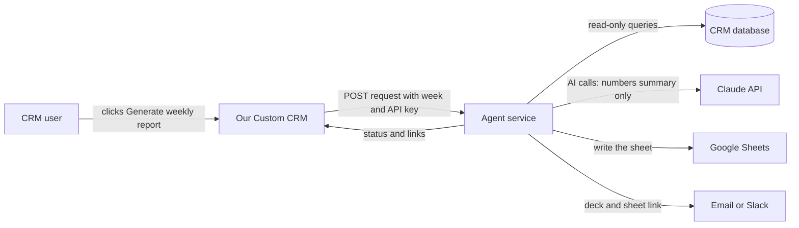
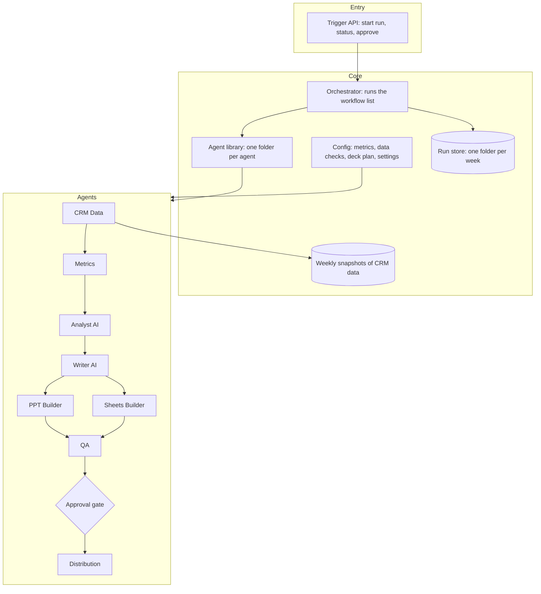
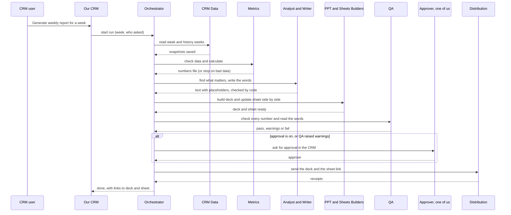
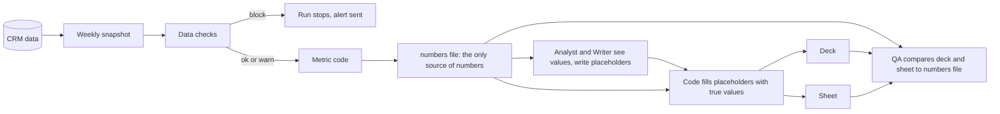
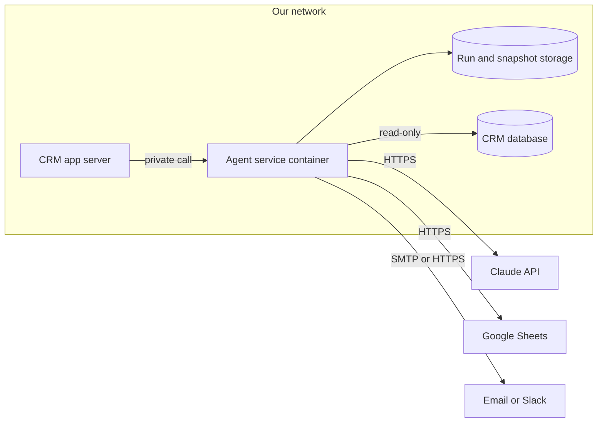

# Weekly CRM Reporting Agents: High-Level Design (HLD)

Version 0.1 draft · 23 Nov 2026 · Vivek and Claude

**The answer in one paragraph.** We add a small agent service next to our Custom CRM. When someone clicks "Generate weekly report" in the CRM, the service runs nine agents in a fixed order. Code reads the CRM (read-only), checks the data and calculates every number. Two AI agents (Claude) find what matters and write the words, using placeholders instead of numbers. Code then builds the PowerPoint deck and updates the Google Sheet. A QA agent checks every number before anything is sent. There is no schedule: it runs only when asked, and each report covers one week. Everything lives in one service, one run folder per week, and plain config files we can edit.

**Confidence scores.** Every section ends with a score from 0 to 100. 90–100: straight from the BRD and SPEC, or a hard rule. 60–89: a sound design choice that needs our yes. Below 60: depends on something not checked yet, usually our CRM schema or hosting.

---

## 1. What we are building and why

| Item | Answer |
|---|---|
| Problem | The weekly report is built by hand: slow, sometimes wrong, different each week. |
| Outcome | A PowerPoint deck and a Google Sheet for any chosen week, made from inside our CRM with one click, no manual work. |
| Who uses it | People in our CRM who need the weekly sales picture. Exact list still open. |
| How we measure it | Ready within an hour of the click. Every number matches the CRM. Deck and sheet agree. Reviewer rarely edits after a few weeks. |
| Not included | Schedules, timers, monthly or daily reports, live dashboards, forecasting, changes to the CRM. |

*Confidence: 85 / 100. Taken from the BRD. The user list and measurable targets are still open.*

## 2. Design principles

1. **Code calculates, AI writes.** No number ever comes from the AI. AI text uses placeholders such as `{win_rate}`, and code fills in the true value.
2. **Read-only on the CRM.** The agents can never change CRM data.
3. **One click, one week, one run.** No cron or timer. The run id is the week, for example 2026-W47.
4. **Agents pass files, not chat.** Each agent reads files from the run folder and writes its own file. That makes every step visible and lets a run resume after a failure.
5. **Fixed order, editable list.** The workflow is a written list of steps, so adding or swapping an agent is a config change.
6. **Least access per agent.** Each agent only reaches what its job needs.
7. **Smallest footprint first.** One service, one store, few moving parts. Bigger infrastructure only when a measured need appears.

*Confidence: 90 / 100. These rules come from the BRD and SPEC and from what we agreed.*

## 3. System context: how the agents fit into our CRM

- The CRM gets one new button and one status panel. Everything else lives in the agent service.
- The CRM's own login decides who sees the button. The CRM backend calls the service with a shared API key, so the key never reaches a browser.
- The service reads our CRM database through a read-only database user. If that is not possible, a read-only internal API or an export file works the same way through a different connector.

*Confidence: 70 / 100. On-demand from inside the CRM is decided. Whether the service reads the database, an internal API or an export depends on our CRM, still to confirm.*

## 4. Main components

| Component | Job | AI or code |
|---|---|---|
| Trigger API | Receives the click from the CRM, returns run status and links, takes approvals | Code |
| Orchestrator | Runs steps in order, retries with feedback, stops and alerts, enforces the time limit | Code |
| Agent library | One folder per agent: job, inputs, outputs, retries, and the prompt for AI agents | Config |
| Run store | One folder per week with every file each agent wrote, the state and the log | Files |
| Snapshots | Frozen copy of the CRM data for each week, so history and comparisons stay stable | Files |
| CRM Data agent | Reads the week and the history weeks from the CRM | Code |
| Metrics agent | Runs data checks, then calculates every number | Code |
| Analyst agent | Finds highlights, lowlights, trends and risks, with placeholders only | AI + code check |
| Writer agent | Writes the summary, slide titles, takeaways and notes, with placeholders only | AI + code check |
| PPT Builder | Fills the slide template with real numbers, charts and text | Code |
| Sheets Builder | Writes the week into our one Google Sheet and keeps history | Code |
| QA agent | Code checks every number; AI reads the words for contradictions | Code, then AI |
| Approval gate | Waits for one of us when approval is on or QA raised warnings | Code |
| Distribution | Sends the deck and sheet link; logs who received it | Code |

*Confidence: 80 / 100. Matches the SPEC. Analyst and Writer may merge into one agent after testing.*

## 5. How a run flows

The CRM shows the run's state while it works: reading CRM, calculating, analysing, writing, building, QA check, awaiting OK, sending, done, or stopped.

*Confidence: 85 / 100. This is the SPEC's step list drawn end to end.*

## 6. Data flow and the numbers rule

- **What the AI sees:** metric names, definitions and aggregated values. It does not need customer names or contact details.
- **What the AI may write:** words and placeholders only. Code rejects any digit typed outside a placeholder, and any placeholder that names a metric that does not exist. A rejected answer is retried with the reason, up to three times.
- **Where numbers live:** one numbers file per run. The deck, the sheet and QA all read from it, so they cannot disagree.

*Confidence: 90 / 100. This is the core safety rule, agreed in the BRD and SPEC.*

## 7. Integrations

| Integration | How | Access it needs | Fallback |
|---|---|---|---|
| Our CRM (trigger) | CRM backend calls the Trigger API with a shared key | One API key, server to server | Run from the command line |
| Our CRM (data) | Read-only database user running SELECT queries from a mapping file | SELECT on the tables we need | Internal read-only API, or an export file we pull at run time |
| Claude API | One structured call per AI agent, answer must match a JSON schema | One API key | Offline mode: rule-based text, clearly labelled |
| Google Sheets | Service account edits one shared spreadsheet | Edit on that one sheet only | Local .xlsx file until Google is set up |
| Email | SMTP from one sending address, deck attached, sheet linked | One sending account | Messages saved as files in the run folder |
| Slack (optional) | Incoming webhook for run summaries and alerts | One webhook URL | Email only |

*Confidence: 65 / 100. The pattern is standard. Our CRM's access method, our Google Workspace setup and the delivery channel are still open questions.*

## 8. Technology choices

| Layer | Choice | Why | Alternative if needed |
|---|---|---|---|
| Language | Python | Best libraries for data, PowerPoint and Google Sheets | TypeScript, if our CRM team prefers one language |
| Orchestration | Our own small state machine, files on disk | Nine steps in a fixed order do not need a workflow engine | A durable workflow engine, only if runs grow long or numerous |
| AI | Claude via the Anthropic API, structured JSON output | One call per AI step, validated by code | Another model behind the same client, if ever required |
| Numbers | pandas | Clear, tested calculations | SQL views in the CRM database |
| Deck | python-pptx with a branded template | Native, editable PowerPoint charts | Google Slides API, if we move to Slides |
| Sheet | gspread with a Google service account | Simple access to one sheet | Google Sheets API directly |
| Trigger API | FastAPI | Small, fast to build | Any web framework our CRM team already runs |
| Storage | Run folders and snapshot files | Easy to inspect and resume | A small database for run state, if we need search across runs |
| Secrets | Environment variables or the host's secret store | Never in code or prompts | A managed secrets service in the cloud |

**Evidence note.** These are well-known open-source libraries and public APIs. We have not yet checked exact current versions, quotas or prices. That check happens before we build.

*Confidence: 70 / 100. A sensible, small stack. Versions, quotas and Claude pricing are not yet verified, and the language choice should match our CRM team.*

## 9. Where it runs

- **One container** next to the CRM, on the same private network, so the database never faces the internet.
- **Persistent storage** for run folders and snapshots, backed up with the CRM.
- **Outbound only** to Claude, Google and email. No inbound traffic from the internet, only from the CRM server.

*Confidence: 50 / 100. Hosting is undecided (our server or a cloud). This layout works for either, but we need to confirm where the CRM runs.*

## 10. Security

| Area | Rule |
|---|---|
| CRM access | Read-only database user; queries must be SELECT, checked before running |
| Trigger | Only the CRM server can call the service, with an API key; CRM login decides who sees the button |
| Secrets | API keys and passwords in environment variables or a secret store; never in code, prompts or logs |
| AI data | Only aggregated numbers and metric definitions go to Claude; no customer contact details |
| Google | Service account can edit only our one weekly sheet |
| Delivery | Sends only to the configured recipient list |
| Logs | Every run, approval and change is logged with who and when; no secrets or customer details |
| Retention | Weekly snapshots kept for a set period, then deleted (period to decide) |

*Confidence: 75 / 100. Firm rules. Retention period and whether per-person figures may go to the AI are open.*

## 11. Failure handling

| Failure | What happens |
|---|---|
| CRM unreachable or returns nothing | Retry, then stop and alert; nothing is sent |
| Data check finds a block problem | Stop and alert, with the data-quality report |
| AI answer breaks a rule | Retry with the reason, up to three times, then stop |
| AI service busy or refuses | Retry; fallback model on refusal; then stop |
| Deck or sheet cannot be built | Stop; no half-built output is passed on |
| QA finds a mismatched number | Fail; nothing is sent |
| QA AI raises a concern | Pass with warnings; one of us must approve |
| Run takes longer than 60 minutes | Stop and alert |
| Second click for the same week while running | Refused |

A stopped run keeps all its files. Clicking again resumes from the last step that finished.

*Confidence: 85 / 100. Covers every step in the SPEC. Retry counts and the time limit are starting values.*

## 12. How the agents stay reliable

Agents do all the work. Each agent owns one step, and each uses the right tool for its job: code tools for anything exact, the AI model for judgement and words.

| Agent's tool | Which agents | Why |
|---|---|---|
| Code tools | CRM Data, Metrics, PPT Builder, Sheets Builder, Distribution | Reading data, numbers, files and sending must be exact every time |
| One structured AI call, checked by code | Analyst, Writer | Finding what matters and writing it well needs judgement; code checks every answer |
| AI review that advises | QA | Can flag a contradiction and ask for approval, but code alone decides whether numbers match |

The agents run in a fixed order set by the workflow list. That is what makes each weekly report look and behave the same way, and it is a deliberate choice for consistency, not for cost. Each AI agent's prompt is a file in its agent folder, kept under version control and tested on sample data before each change.

*Confidence: 85 / 100. Matches the agreed safety rule. Prompt quality is only proven once we test on sample data.*

## 13. Agents we bring and keep: build time vs run time

There are two different sets of agents, and it matters not to mix them up.

| | Build-time agents | Run-time agents |
|---|---|---|
| What they are | Agents already installed in our Claude Code | The nine agents inside the reporting system |
| Where they live | Our Claude Code setup (agent prompt files and skills) | The project's agent library, one folder per agent |
| When they work | While we design, write and test the system | Every time someone clicks Generate weekly report |
| Do they touch CRM data? | No | Yes, read-only |

**Build-time agents we reuse.** These are installed in our Claude Code today.

| Installed agent or skill | Where it helps |
|---|---|
| Workflow Architect, Multi-Agent Systems Architect, Software Architect | Workflow, agent handoffs, failure paths, this HLD and the LLD |
| Product Manager | Keeping BRD and SPEC in step with what we build |
| Prompt Engineer | Writing and testing the Analyst, Writer and QA prompts |
| Data Engineer | CRM field mapping, snapshots and data checks |
| Security Architect | Read-only access, secrets, what may go to the AI |
| Test Automation Engineer, Code Reviewer | Tests on sample data and review of each agent |
| Technical Writer | README and run guide |
| Skills: pptx, xlsx, claude-api, testing-strategy | Deck building, sheet layout, correct Claude API use, test plan |

**Installed agents that become patterns for run-time agents.** We do not copy them as they are. Their instructions are a starting point for our own agents' jobs and prompts.

| Installed agent | Pattern for our run-time agent |
|---|---|
| Sales Data Extraction Agent | CRM Data: careful extraction, never drops a record, logs every error |
| Data Consolidation Agent | Metrics: territory, rep and pipeline summaries |
| Pipeline Analyst | Analyst: pipeline health, velocity, stuck deals |
| Executive Summary Generator | Writer: lead with the point, short and plain |
| Report Distribution Agent | Distribution: right people, delivery log, retries |

Agents that prove useful are kept in the agent library and reused in the next project. A new agent is one folder plus one line in the workflow list.

*Confidence: 75 / 100. The installed agents and skills are confirmed from our Claude Code setup. How much each pattern helps will only be clear once we write the prompts.*

## 14. Risks

| Risk | Effect | How we reduce it |
|---|---|---|
| Our CRM data is messy | Wrong or missing numbers | Data checks that block or warn; data notes in the deck |
| CRM does not keep stage history | "Deals moved forward" missing at first | Our own weekly snapshots fill in from the second report |
| AI writes something misleading | Wrong message in the deck | Placeholders, code checks, QA review, optional approval |
| Google access set up wrongly | Sheet not updated | Service account limited to one sheet; local file as fallback |
| Claude cost grows | Budget surprise | Three AI calls per run, up to nine if every check forces a retry; cost logged per run |
| Hosting undecided | Build delayed | Design works on our server or in the cloud |

*Confidence: 75 / 100. Known risks with simple controls. Cost per run is not yet measured.*

## 15. Decisions and open questions

**Decided**
- No schedule; on-demand from a button in our CRM; one week per report.
- Two outputs: PowerPoint deck and Google Sheet.
- Nine agents in a fixed order; code calculates, AI writes with placeholders.
- Read-only access to the CRM.

**Open (blocking design detail)**
1. How the service reads our CRM: database, internal API or export.
2. Where it runs: our server or a cloud.
3. Python or TypeScript, to match our CRM team.
4. Google Workspace setup and the shared sheet.
5. Delivery channel: email, Slack or Teams.
6. Approval on at the start: yes or no.
7. Snapshot retention period.
8. Optional: research how other CRMs do AI weekly reporting, with sources, if we want a comparison.

*Confidence: 90 / 100. These are the known gaps.*

## 16. What comes next

1. Answer the open questions above and in the SPEC.
2. Map our CRM fields to the standard tables.
3. Low-level design: each agent's exact inputs, outputs, prompts and file formats.
4. Then build, one agent at a time, starting with CRM Data and Metrics on sample data.

*Confidence: 90 / 100. Follows the order we agreed.*
