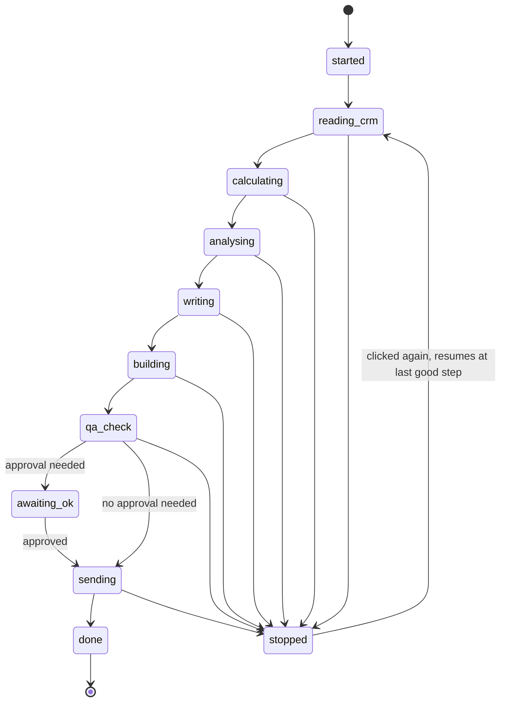

# Weekly CRM Reporting Agents: Low-Level Design (LLD)

Version 0.1 draft · 23 Nov 2026 · Vivek and Claude

**What this document is.** The HLD says what the parts are and how they fit. This LLD says exactly how each part works: the files each agent reads and writes, every field in those files, the config formats, the AI prompts, the trigger API, the deck and sheet layouts, error handling and tests. A developer should be able to build from it without guessing.

**Confidence scores.** Same scale as the other documents. 90–100: from the BRD, SPEC or HLD, or a hard rule. 60–89: a sound design choice that needs our yes. Below 60: depends on something not checked yet, usually our CRM schema or hosting.

---

## 1. Project layout

```
crm-weekly-agents/
  docs/                      BRD, SPEC, HLD, this LLD
  agents/                    agent library: one folder per agent
    crm_data/agent.yaml
    metrics/agent.yaml
    analyst/agent.yaml, prompt.md
    writer/agent.yaml, prompt.md
    ppt_builder/agent.yaml
    sheets_builder/agent.yaml
    qa/agent.yaml, prompt.md
    distribution/agent.yaml
  workflows/weekly_report.yaml   the ordered list of steps
  config/
    settings.example.yaml    copied to settings.yaml (git-ignored)
    metrics.yaml             the metric list
    data_checks.yaml         the data checks and their severity
    deck.yaml                the slide plan
    crm_mapping.yaml         our CRM fields mapped to standard tables
  templates/weekly_report.pptx   optional branded slide template
  src/crm_weekly_agents/     the service code
  tests/                     unit, agent and end-to-end tests
  runs/                      one folder per week (git-ignored)
  data/snapshots/            frozen weekly CRM copies (git-ignored)
  .env                       secrets (git-ignored)
```

*Confidence: 85 / 100. A plain layout that keeps config, prompts and code apart. Folder names can change in the build.*

## 2. Run folder and file chain

Every run lives in `runs/<run_id>/`, for example `runs/2026-W47/`. Files are written atomically: written to a temporary name, then renamed, so a crash never leaves half a file.

| File | Written by | Read by | Purpose |
|---|---|---|---|
| run_config.json | Orchestrator | every agent | The week, who asked, settings for this run |
| state.json | Orchestrator | Orchestrator, Trigger API | Current state and each step's status |
| log.jsonl | everyone | us | One line per event: time, event, details |
| .lock | Orchestrator | Orchestrator | One run per week at a time |
| snapshot_manifest.json | CRM Data | Metrics | Which snapshot folders this run uses |
| count_sheet.json | CRM Data | Metrics, QA | Record counts this week and last week |
| data_quality.json | Metrics | Analyst, PPT Builder, Sheets Builder | Data problems found, block or warn |
| numbers.json | Metrics | Analyst, Writer, PPT Builder, Sheets Builder, QA | The only source of numbers |
| insights.json | Analyst | Writer, QA | What matters this week, with metric ids |
| text.json | Writer | PPT Builder, Sheets Builder, QA, Distribution | All words for the deck and sheet, with placeholders |
| deck.pptx | PPT Builder | QA, Distribution | The deck |
| deck_manifest.json | PPT Builder | QA | Every value written on every slide |
| sheet_update.json | Sheets Builder | QA, Distribution | Sheet link and what was written |
| qa_report.json | QA | Orchestrator, Distribution, us | Pass, pass with warnings, or fail |
| approval.json | Trigger API | Orchestrator | Who approved and when |
| receipts.json | Distribution | us | Who received the report |
| outbox/, alerts/ | Distribution, Orchestrator | us | Saved emails when email is in outbox mode |

A step is done only when its status is `done` in state.json **and** every output file it lists exists.

*Confidence: 90 / 100. This is the SPEC's file chain with names fixed.*

## 3. File formats

All dates are ISO (`2026-11-16`). Money is a plain number in the settings currency. Percentages are 0 to 100.

### run_config.json

```json
{
  "run_id": "2026-W47",
  "week_start": "2026-11-16",
  "week_end": "2026-11-22",
  "timezone": "UTC",
  "currency": "USD",
  "requested_by": "vivek",
  "approval_required": true,
  "recipients": ["sales-leads@ourcompany.example"]
}
```

### state.json

```json
{
  "run_id": "2026-W47",
  "state": "building",
  "reason": null,
  "created_at": "2026-11-23T09:02:11Z",
  "updated_at": "2026-11-23T09:04:40Z",
  "steps": {
    "read_crm":  {"status": "done", "attempt": 1, "seconds": 12.4, "summary": {"weeks": 8}},
    "calculate": {"status": "done", "attempt": 1},
    "analyse":   {"status": "done", "attempt": 2, "error": null},
    "write":     {"status": "done", "attempt": 1},
    "build_deck":   {"status": "running", "attempt": 1},
    "update_sheet": {"status": "done", "attempt": 1}
  },
  "history": [{"state": "started", "at": "2026-11-23T09:02:11Z"}]
}
```

Step status is one of `pending`, `running`, `done`, `failed`, `waiting`.

### numbers.json

```json
{
  "run_id": "2026-W47",
  "week_start": "2026-11-16",
  "week_end": "2026-11-22",
  "currency": "USD",
  "history_weeks": ["2026-W40", "...", "2026-W47"],
  "metrics": {
    "win_rate": {
      "id": "win_rate",
      "name": "Win rate",
      "group": "Results",
      "unit": "percent",
      "definition": "Won deals divided by all deals closed during the week.",
      "good_direction": "up",
      "current": 41.7,
      "previous": 35.0,
      "change": 6.7,
      "change_pct": 19.14,
      "history": [30.0, null, 38.5, 35.0, 41.7],
      "reason_missing": null
    }
  },
  "breakdowns": {
    "by_stage": [{"stage": "Proposal", "open_count": 12, "open_value": 210400.0}],
    "by_owner": [{"owner_name": "...", "team": "North", "won_count": 3, "won_value": 81200.0,
                  "pipeline_value": 140000.0, "calls": 11, "meetings": 4, "emails": 17}]
  }
}
```

`change_pct` is empty when last week was zero or empty. `reason_missing` explains an empty `current`, for example no deals closed.

### data_quality.json

```json
{"issues": [
  {"check_id": "DQ01", "severity": "warn", "description": "Deals with no owner",
   "count": 3, "message": "3 deals have no owner; they are left out of per-person views."}
]}
```

### insights.json

```json
{
  "drafted_by": "claude-opus-5-5",
  "usage": {"input_tokens": 0, "output_tokens": 0},
  "insights": {
    "headline":   {"text": "Win rate rose to {win_rate} ({win_rate.change_pct}).", "metric_ids": ["win_rate"]},
    "highlights": [{"text": "...", "metric_ids": ["..."]}],
    "lowlights":  [],
    "trends":     [],
    "risks":      []
  }
}
```

### text.json

```json
{
  "drafted_by": "claude-opus-5-5",
  "text": {
    "summary_title": "Wins rose while the pipeline held steady",
    "summary_bullets": ["Won value reached {deals_won_value} ({deals_won_value.change_pct})."],
    "slides": [
      {"slide_id": "won_trend", "title": "...", "takeaway": "...", "notes": "..."}
    ],
    "sheet_summary": ["..."]
  }
}
```

### deck_manifest.json

```json
{
  "slide_count": 9,
  "slides": [
    {"index": 2, "id": "scorecard", "charts": 0,
     "expected": ["Win rate", "41.7%", "35.0%", "+19.1%"]}
  ]
}
```

### sheet_update.json

```json
{"mode": "google", "link": "https://docs.google.com/spreadsheets/d/<id>",
 "tabs": {"Summary": 24, "History": 9, "Pipeline": 5, "Team": 7, "Data quality": 2},
 "history_row": {"week": "2026-W47", "week_start": "2026-11-16", "win_rate": 41.7}}
```

### qa_report.json

```json
{"result": "pass_with_warnings",
 "problems": [],
 "warnings": ["won_trend: the takeaway says the trend is steady but it rose three weeks running"],
 "checks_run": ["deck numbers", "no unfilled placeholders", "sheet history row", "AI review"],
 "reviewed_by": "code + claude-opus-5-5"}
```

### receipts.json

```json
{"sent": [{"recipient": "sales-leads@ourcompany.example", "channel": "email", "status": "sent"}],
 "failed": []}
```

*Confidence: 85 / 100. Every field the SPEC needs is here. Field names may be tuned in the build.*

## 4. Config formats

### workflows/weekly_report.yaml

```yaml
id: weekly_report
name: Weekly CRM report (PowerPoint + Google Sheet)
steps:
  - {id: read_crm,     agent: crm_data,       state: reading_crm}
  - {id: calculate,    agent: metrics,        state: calculating}
  - {id: analyse,      agent: analyst,        state: analysing}
  - {id: write,        agent: writer,         state: writing}
  - {id: build_deck,   agent: ppt_builder,    state: building, parallel_group: build}
  - {id: update_sheet, agent: sheets_builder, state: building, parallel_group: build}
  - {id: qa,           agent: qa,             state: qa_check}
  - {id: approve,      gate: approval,        state: awaiting_ok}
  - {id: deliver,      agent: distribution,   state: sending}
```

Each step names exactly one `agent` or one `gate`. Steps next to each other with the same `parallel_group` run side by side.

### agents/&lt;id&gt;/agent.yaml

```yaml
id: analyst
name: Analyst
job: Read the numbers and find what matters this week. Never types a number.
kind: ai                 # code | ai
handler: crm_weekly_agents.agents.analyst:AnalystAgent
inputs: [numbers.json, data_quality.json]
outputs: [insights.json]
max_attempts: 3          # tries before the run stops
prompt: prompt.md        # AI agents only
effort: high             # AI agents only
max_tokens: 8000         # AI agents only
```

| Agent | kind | max_attempts | effort | max_tokens |
|---|---|---|---|---|
| crm_data | code | 3 | | |
| metrics | code | 1 | | |
| analyst | ai | 3 | high | 8000 |
| writer | ai | 3 | medium | 8000 |
| ppt_builder | code | 2 | | |
| sheets_builder | code | 3 | | |
| qa | ai | 2 | medium | 4000 |
| distribution | code | 2 | | |

### config/settings.yaml (main fields)

| Field | Example | Meaning |
|---|---|---|
| timezone, currency | UTC, USD | From our CRM (to confirm) |
| history_weeks | 8 | Weeks used for trends, 2 to 26 |
| run_time_limit_minutes | 60 | A run stops past this |
| approval_required | true | Ask one of us before sending |
| crm.adapter | sql | `sample` for development, `sql` for our CRM |
| llm.model | claude-opus-5-5 | Model for the three AI agents |
| llm.offline_fallback | true | No API key: rule-based text, labelled as such |
| thresholds.stuck_days, inactive_days | 30, 14 | Deal health limits |
| sheets.mode | google | `local` writes an .xlsx file instead |
| delivery.recipients, alert_recipients | lists | Who gets reports and who gets failure alerts |
| delivery.email.mode | smtp | `outbox` saves emails as files instead of sending |

Secrets are never in settings. They come from environment variables: `ANTHROPIC_API_KEY`, `CRM_DB_URL`, `GOOGLE_SHEET_ID`, `GOOGLE_SERVICE_ACCOUNT_FILE`, `SMTP_HOST`, `SMTP_USER`, `SMTP_PASSWORD`, `SLACK_WEBHOOK_URL`, `CRM_AGENTS_API_KEY`.

*Confidence: 80 / 100. Formats are settled. Values such as approval on, history weeks and thresholds are proposals.*

## 5. Standard CRM tables

Whatever our CRM calls things, the CRM Data agent returns these tables and columns. `config/crm_mapping.yaml` holds one SELECT query per table that returns exactly these names.

| Table | Columns |
|---|---|
| deals | deal_id, name, account_id, owner_id, stage, amount, currency, created_at, closed_at, status (open, won, lost), lost_reason, expected_close_date, last_activity_at, stage_changed_at |
| leads | lead_id, created_at, source, status, converted_at, owner_id |
| activities | activity_id, type (call, meeting, email), owner_id, occurred_at, deal_id |
| users | user_id, name, team |
| stages | stage, order, is_closed |
| targets | week_start, owner_id ('ALL' for the team), target_amount |

Rules for the mapping queries:

1. Each query is a single SELECT or WITH … SELECT. Anything else is refused before it runs.
2. `:week_start` and `:week_end` are passed in as parameters.
3. `deals` describes each deal as it stood at `:week_end`. If our CRM only keeps the current state, we return the current state; our own weekly snapshots then supply last week's state from the second report onward.
4. The database user can only read. The query check is a second line of defence, not the first.
5. `deals`, `users` and `stages` are required. The rest may be empty if the CRM does not hold them.

*Confidence: 50 / 100. The standard tables are firm. Whether our CRM holds every column, and as-of-week values, is not yet checked against our schema.*

## 6. Orchestrator

### 6.1 Starting a run

1. Receive `week` (default: the last full Monday-to-Sunday week) and `requested_by`.
2. Check the week looks like `2026-W47` and is a real ISO week.
3. Take the lock `runs/<week>/.lock`. If a lock exists and is younger than the time limit, refuse: "A run for this week is already going." An older lock is from a crashed run and is taken over.
4. Write run_config.json.
5. If the request asks to redo from a step, mark that step and every later step `pending`, and delete approval.json.
6. If the run is already `done` and no redo was asked, return its status and do nothing.
7. Decide offline mode: offline when asked, or when no Claude API key is set and offline_fallback is on.
8. Execute the steps (6.2). Release the lock at the end, whatever happens.

### 6.2 Executing steps

```
for each group of steps (a single step, or a parallel group):
    skip steps that are already done (status done and outputs exist)
    if nothing left in the group: continue
    if past the time limit: stop the run
    if the step is the approval gate: handle it (6.4); if waiting, return
    set the run state to the step's state
    run the step, or run the group's steps side by side
    if any step failed: stop the run with its reason
set the run state to done
```

### 6.3 Running one step

```
for attempt 1 .. max_attempts:
    mark step running
    call the agent with: settings, run folder, run_config, its spec, attempt number, feedback
    if every output file exists: mark done (attempt, seconds, summary) and return
    if the agent said Blocked: mark failed and stop at once (no retry)
    otherwise: keep the error as feedback for the next attempt
        wait 2, 4, 8 seconds between attempts, except after an AI rule failure
mark failed with the last error
```

Three kinds of failure:

| Kind | Example | What happens |
|---|---|---|
| Retryable error | CRM timeout, Google quota, AI service busy | Try again up to max_attempts |
| Rule failure (AI) | AI typed a number or named an unknown metric | Try again at once, with the reasons sent back to the AI |
| Blocked | Bad data, QA fail | Stop at once, no retry |

### 6.4 Approval gate

1. Approval is needed if `approval_required` is on, or QA passed with warnings.
2. If not needed: mark the gate done with the reason, carry on.
3. If approval.json exists: mark done with the approver's name, carry on.
4. Otherwise: mark the gate `waiting`, set the run state `awaiting_ok` with the reason, release the lock and return. The CRM shows an Approve button.
5. Approving writes approval.json and runs the Orchestrator again for that week. Done steps are skipped, so it goes straight to Distribution.

### 6.5 Stopping

Set state `stopped` with the reason, then alert the `alert_recipients` by email (and Slack if set). An alert failure is logged but never hides the original failure. The message says nothing was sent and that clicking again resumes from the last good step.

### 6.6 Run states



The arrow from stopped goes to whichever step failed, not always to reading CRM.

*Confidence: 85 / 100. Follows the SPEC. Retry counts, waits and the time limit are starting values.*

## 7. Agent designs

### 7.1 CRM Data (code)

**Gets:** run_config.json, read-only CRM access.

**Steps**
1. Build the connector named in settings (`sample` or `sql`). Test the connection.
2. List the weeks: the report week plus `history_weeks − 1` weeks before it.
3. For each week: if it is a past week and `data/snapshots/<week>/` already exists, reuse it (frozen). Otherwise extract all six standard tables as they stood at that week's end, and save them as CSV files plus `meta.json` (week, start, end, counts, extracted_at).
4. The report week is always extracted fresh when this step runs.
5. If the report week has no deals and no users at all, stop (Blocked).
6. Write snapshot_manifest.json (week and folder for each) and count_sheet.json (counts this week and last week).

**Errors:** connection or query failure is retryable (3 tries). Empty CRM is Blocked.

### 7.2 Metrics (code only)

**Gets:** the snapshots, metrics.yaml, data_checks.yaml.

**Steps**
1. Load all snapshots from the manifest, oldest first.
2. Run the data checks on the report week, comparing with last week where needed (section 8). Write data_quality.json.
3. If any `block` issue: stop (Blocked), naming the checks.
4. For every week, run every metric function. The function for week N may look at week N−1 (for "deals moved forward").
5. For each metric: current, previous, change, change_pct, history. Round to 4 decimals. Empty values stay empty, never zero.
6. Build breakdowns from the report week: by stage (open deals and value) and by owner (won, pipeline, activities).
7. Write numbers.json.

**Errors:** a metric function crash stops the run (max_attempts 1): a wrong number is worse than no report.

### 7.3 Analyst (AI, then code check)

**Gets:** numbers.json, data_quality.json, the prompt in agents/analyst/prompt.md.

**Steps**
1. Build the input: for each metric, id, name, group, unit, definition, good direction, this week, last week, change %, direction and history; plus the data-quality messages.
2. If this is a retry, add: "Your previous answer was rejected for these reasons. Fix every one:" and the reasons.
3. One Claude call with the Insights schema (section 10).
4. Code checks every point (section 9): at least one metric id, every id real, no digit outside a placeholder, every placeholder real; at most three points per list.
5. Any problem: rule failure (retry with the reasons). Otherwise write insights.json.

**Offline mode:** rank metrics by size of change. The three biggest good moves are highlights and the three biggest bad moves are lowlights. Three weeks rising or falling in a row is a trend. Any stuck, overdue or inactive deals are risks. The same placeholders and checks apply, and the file is marked "rules (offline, no AI)".

### 7.4 Writer (AI, then code check)

**Gets:** insights.json, numbers.json, deck.yaml, the prompt in agents/writer/prompt.md.

**Steps**
1. Build the input: the Analyst's points; for each metric its id, name, unit, definition, direction (up, down, flat, no data) and whether that is good; and the chart slides (id, what it shows, its metrics). The Writer is not given raw values. It only needs to know which way each metric moved.
2. Retry feedback as for the Analyst.
3. One Claude call with the Text schema (section 10).
4. Code checks: one slide entry for every chart slide id, in the same order; three to six summary bullets; one to six sheet lines; every string passes the placeholder rule.
5. Any problem: rule failure. Otherwise write text.json.

**Offline mode:** summary bullets come from the Analyst's headline, highlights and lowlights. Slide titles are the deck's default titles. Each takeaway is the first Analyst point about that slide's metrics. The notes are the metric definitions.

### 7.5 PPT Builder (code)

**Gets:** numbers.json, text.json, data_quality.json, deck.yaml, the optional template.

**Steps**
1. Open `templates/weekly_report.pptx` if it exists, else a blank default deck.
2. Fill every placeholder in text.json with the true value (section 9), recording each value written.
3. Add the slides in section 12's order. Charts are native PowerPoint charts drawn from numbers.json, so they stay editable.
4. Speaker notes come from the Writer's notes.
5. Write deck_manifest.json: for each slide, its id, chart count, and every value text expected on it.
6. Save deck.pptx.

**Errors:** a missing metric, an unfilled placeholder or a failed save stops the step. A half-built deck is never written as deck.pptx.

### 7.6 Sheets Builder (code)

**Gets:** numbers.json, text.json, data_quality.json, sheet settings.

**Steps**
1. Open the target: our Google Sheet through the service account, or the local .xlsx.
2. Rewrite the tabs in section 13. For History, read the existing rows, remove any row for this week, add this week's row, sort by week. So the week is never written twice.
3. Write raw numbers (not formatted text), so the sheet can be used for its own sums and charts.
4. Write sheet_update.json with the link, rows per tab and this week's history row.

**Errors:** permission or quota errors are retryable (3 tries), then the run stops.

### 7.7 QA (code, then AI)

**Gets:** deck.pptx, deck_manifest.json, sheet_update.json, numbers.json, text.json.

**Code checks (any failure is a problem: the run fails)**
1. The deck opens and has the expected number of slides.
2. Every expected value text appears on its slide.
3. Every slide has the expected number of charts.
4. No unfilled `{placeholder}` remains anywhere in the deck.
5. The sheet's History tab has exactly one row for this week.
6. Every metric in that row equals numbers.json, within rounding.

**AI review (only if the code checks pass and we are online)**
1. Fill the summary, titles and takeaways with real values.
2. Send them with a table of each metric's this-week value, last-week value and good direction.
3. One Claude call with the Review schema. Each issue becomes a warning, not a problem.
4. If the AI review itself fails to run, that is a warning too: a person then approves.

**Result:** `fail` if any problem, `pass_with_warnings` if any warning, else `pass`. Write qa_report.json. On fail, stop (Blocked).

### 7.8 Distribution (code)

**Gets:** qa_report.json, deck.pptx, sheet_update.json, text.json, recipients.

**Steps**
1. Refuse if QA failed.
2. Copy the deck to `outputs/<week>/weekly-report-<week>.pptx`.
3. Build the email: subject "Weekly CRM report 2026-W47", the filled summary title and bullets, the sheet link, and the deck attached.
4. Send to each recipient (SMTP), up to three tries each. In outbox mode, save each email as an .eml file instead.
5. Post a short summary to Slack if a webhook is set.
6. Write receipts.json: sent and failed lists. If anyone failed, alert us with the names.

**Errors:** a failed recipient does not stop the run. It is listed and alerted.

*Confidence: 80 / 100. Each agent's steps follow the SPEC. The Analyst and Writer may merge after testing, and the deck and sheet details may change once we see real data.*

## 8. Metric definitions and data checks

### Metrics (starting list, to agree)

| id | Name | Unit | Good | How it is calculated |
|---|---|---|---|---|
| new_leads | New leads | count | up | Leads with created_at inside the week |
| new_deals | New deals | count | up | Deals with created_at inside the week |
| pipeline_value | Open pipeline value | currency | up | Sum of amount for deals with status open at week end |
| deals_advanced | Deals moved forward | count | up | Deals whose stage order is higher than in last week's snapshot. Empty in the first week |
| deals_won_count | Deals won | count | up | status won and closed_at inside the week |
| deals_won_value | Won value | currency | up | Sum of amount for those deals |
| deals_lost_count | Deals lost | count | down | status lost and closed_at inside the week |
| deals_lost_value | Lost value | currency | down | Sum of amount for those deals |
| win_rate | Win rate | percent | up | Won ÷ (won + lost) closed in the week. Open deals are not in the denominator. Empty if none closed |
| avg_deal_size | Average won deal size | currency | up | Won value ÷ deals won. Empty if none won |
| target_attainment | Target attainment | percent | up | Won value ÷ the team target for the week. Empty if no target |
| avg_days_to_close | Average days to close | days | down | Mean of closed_at − created_at for deals won in the week |
| lead_conversion_rate | Lead conversion rate | percent | up | Of the week's new leads, the share converted by week end. Empty if no new leads |
| activities_total | Activities logged | count | up | Activities with occurred_at inside the week |
| calls, meetings, emails | Calls, Meetings, Emails | count | up | Same, by type |
| stuck_deals | Stuck deals | count | down | Open deals with no stage change for more than stuck_days |
| overdue_deals | Overdue deals | count | down | Open deals with expected_close_date before week end |
| inactive_deals | Inactive deals | count | down | Open deals with no activity, or none for more than inactive_days |

**Definition traps we chose on purpose**
- Win rate counts only deals closed this week. The other common version divides by all deals touched this week, and it gives a lower number. We must agree which one we mean.
- Lead conversion looks only at this week's new leads, so a lead converted later does not change last week's figure.
- Metric names must not contain digits, because the AI text quotes them.

### Data checks

| id | Check | Default severity |
|---|---|---|
| DQ01 | Deals with no owner | warn |
| DQ02 | Duplicate deal ids | block |
| DQ03 | Deals in a stage not in the stages table | warn |
| DQ04 | Deals with a negative amount | block |
| DQ05 | Won or lost deals with no close date | warn |
| DQ06 | Deals or leads created after week end | warn |
| DQ07 | No deals at all | block |
| DQ08 | A table shrank by 50% or more since last week | warn |
| DQ09 | Deals with no amount | warn |

Each check returns a count and a plain message. Severity and on/off live in data_checks.yaml.

*Confidence: 55 / 100. The calculations are exact. Which metrics we keep, the win-rate definition and which checks block are not yet agreed, and all depend on our CRM's data.*

## 9. Placeholder rule

The rule that stops invented numbers. It applies to every string an AI agent writes.

**Grammar:** `{metric_id}` or `{metric_id.field}`, where field is one of `current`, `previous`, `change`, `change_pct`. Metric ids are lower case letters, digits and underscores, starting with a letter.

**Checks on AI text**
1. Every placeholder names a metric in numbers.json.
2. Every field is one of the four above.
3. After removing the placeholders, no digit remains.
4. After removing the placeholders, no stray `{` or `}` remains.

**How values are written when filled**

| Unit | current / previous | change | change_pct |
|---|---|---|---|
| count | 1,234 | +12 | +5.0% |
| currency | USD 81,200 | +USD 4,100 | +5.3% |
| percent | 41.7% | +6.7 pts | +19.1% |
| days | 23.4 days | -2.1 days | -8.2% |
| empty value | n/a | n/a | n/a |

*Confidence: 90 / 100. The rule is agreed. Exact formatting can change with our house style.*

## 10. Claude calls

| Setting | Value |
|---|---|
| Model | claude-opus-5-5, set in settings so it can change without code |
| Call type | One request per agent attempt: a system prompt from prompt.md, one user message with JSON input |
| Output | Structured output: the answer must match a JSON schema built from the file formats in section 3 (no extra fields, every field required) |
| Effort | Analyst high, Writer medium, QA medium |
| Max output | Analyst 8000, Writer 8000, QA 4000 tokens |
| Refusal | If the model declines, a fallback model is tried on the same request on Anthropic's side. A final decline counts as a retryable error |
| Cut off | If the answer hits max tokens, it is a retryable error and the log says to raise max_tokens |
| SDK retries | The SDK itself retries busy or network errors twice before our own attempts |
| Cost | Input and output tokens are saved in each file and the log, so we can see cost per run |

**Schemas**
- Analyst → Insights: headline {text, metric_ids}; highlights, lowlights, trends, risks: lists of {text, metric_ids}.
- Writer → Text: summary_title; summary_bullets (list); slides: list of {slide_id, title, takeaway, notes}; sheet_summary (list).
- QA → Review: issues: list of {where, problem}.

**Note:** model name, structured-output and fallback options are taken from the Claude API reference we have today. We check them against the live documentation before we build.

*Confidence: 75 / 100. The call design is simple and standard. API details must be re-checked at build time.*

## 11. AI prompts

These are the starting prompts. Each lives in its agent folder and is changed only with a test run on sample data.

### Analyst

```
You are the Analyst agent in a weekly sales reporting pipeline for our company's own CRM.

You receive one JSON document: the metrics for the chosen week (with last week's value,
the change and a short history), and any data-quality warnings. Your job is to find what
matters this week and say it plainly.

Write:
- headline: the single most important thing about this week.
- highlights: up to three moves in the good direction.
- lowlights: up to three moves in the bad direction.
- trends: up to three patterns across the history weeks.
- risks: up to three things that need attention, such as stuck, overdue or inactive deals,
  or a number that depends on data flagged in the warnings.

Rules you must follow:
1. Never type a digit. Refer to values only with placeholders: {metric_id},
   {metric_id.previous}, {metric_id.change}, {metric_id.change_pct}. Code fills them in.
2. Every point lists the metric ids it is about. Use only ids from the input.
3. "Good direction" is given for each metric. A rise in lost value or stuck deals is bad.
4. Do not invent causes. If the data does not show why something moved, describe the move.
5. If a metric has no value this week, do not write about it as if it had one.
6. Plain English, short sentences, about twenty-five words per point at most.
```

### Writer

```
You are the Writer agent in a weekly sales reporting pipeline for our company's own CRM.

You receive the Analyst's points, the list of metrics (id, name, unit, which way it moved
and whether that is good), and the list of chart slides. You write the words for a
PowerPoint deck and the summary tab of a Google Sheet.

Write:
- summary_title: a short title stating the week's main point.
- summary_bullets: three to six bullets, most important first.
- slides: exactly one entry for every chart slide id, in the same order, each with a title
  that states a finding, a one-sentence takeaway, and two or three sentences of speaker
  notes that include the plain definition of the main metric.
- sheet_summary: three to six lines for the sheet's summary tab.

Rules you must follow:
1. Never type a digit. Use only placeholders for values.
2. Use only metric ids and slide ids you are given.
3. Say "rose" or "fell" only when the metric's direction says so. Do not call a bad move good.
4. Stay with what the Analyst found. Add no causes or claims.
5. Plain English for a busy reader: short sentences, no jargon, no exclamation marks.
```

### QA reviewer

```
You are the QA reviewer in a weekly sales reporting pipeline.

Code has already checked that every number in the deck and the sheet matches the
calculated numbers. Your job is the part code cannot do: read the finished words with
the real numbers filled in, and flag anything a careful reader would object to.

Flag: a sentence that contradicts the numbers; a claim about a cause the numbers do not
support; two statements that contradict each other; wording that is unclear or
misleading. Do not flag style preferences. If there is nothing to flag, return an empty
list. For each issue give where it is (summary, or the slide id) and one sentence saying
what is wrong.
```

*Confidence: 70 / 100. Clear rules, but prompts are only proven by testing on sample and then real data.*

## 12. Deck layout

| # | Slide | Content | Source |
|---|---|---|---|
| 1 | Title | "Weekly CRM report", the week's dates, when it was made | run_config |
| 2 | Summary | Writer's summary title and three to six bullets | text.json, filled |
| 3 | Scorecard | Table: metric, this week, last week, change % for the scorecard metrics | numbers.json |
| 4 | Won value trend | Line chart over the history weeks, title and takeaway | numbers + text |
| 5 | Pipeline trend | Line chart | numbers + text |
| 6 | Pipeline by stage | Bar chart of open value per stage | breakdowns.by_stage |
| 7 | Won value by person | Bar chart per owner | breakdowns.by_owner |
| 8 | Activity trend | Lines for calls, meetings and emails | numbers + text |
| 9 | Deals needing attention | Table: stuck, overdue, inactive, this week and last week | numbers + text |
| 10 | Data notes (only when warnings) | Each data-quality warning message | data_quality.json |

The order and the chart slides come from deck.yaml. A branded template sets fonts and colours; slide layouts are picked by index (title, content, title only), also set in deck.yaml.

*Confidence: 65 / 100. A sensible first deck. The slide count, the charts and whether we have a template are open questions.*

## 13. Google Sheet layout

One Google Sheet for all weeks. Each run rewrites the tabs below; History keeps one row per week.

| Tab | Rows | Columns |
|---|---|---|
| Summary | The week, who made it, the Writer's sheet summary (filled), then every metric | metric, this week, last week, change %, definition |
| History | One row per week, sorted by week | week, week_start, week_end, then one column per metric id |
| Pipeline | One row per stage | stage, open deals, open value |
| Team | One row per person | owner, team, won deals, won value, pipeline value, calls, meetings, emails |
| Data quality | One row per issue | check, severity, count, message |

New metrics add a History column on the next run; old weeks show empty in that column.

*Confidence: 70 / 100. Simple and safe to re-run. Whether one sheet is kept forever or a new one each year is open.*

## 14. Trigger API and the CRM button

The CRM backend calls the agent service. Browsers never call it directly, so the key stays on the server.

| Endpoint | Body or query | Returns |
|---|---|---|
| POST /reports | {"week": "2026-W47" (optional, default last full week), "requested_by": "vivek", "redo_from_step": null} | 202 {"run_id": "2026-W47", "state": "started"}. 409 if a run for that week is already going |
| GET /reports/{run_id} | | 200 state.json plus links to the deck and sheet and the QA result. 404 if no such run |
| POST /reports/{run_id}/approve | {"approved_by": "vivek", "note": ""} | 202, delivery starts. 409 if the run is not waiting for approval |
| GET /health | | 200 {"ok": true} |

Every call needs the header `X-API-Key`, matching `CRM_AGENTS_API_KEY`. A wrong key returns 401.

POST /reports starts the run in the background and returns straight away. The run keeps going even if the CRM page is closed.

**In the CRM**
1. A "Generate weekly report" button with a week picker (default: last full week). Only users we allow can see it.
2. After the click, a status panel asks GET /reports/{run_id} every few seconds while the page is open, and shows the state in plain words.
3. When waiting for approval, the panel shows the QA warnings, a link to preview the deck, and an Approve button.
4. When done, it shows links to the deck and the sheet. When stopped, it shows the reason.

*Confidence: 70 / 100. The API is small and standard. The CRM side depends on how our CRM is built, which we still need to confirm.*

## 15. Logging and cost

- **log.jsonl** gets one line per event: run requested, state change, step start and end, attempt failed (with the error), approval, alert sent. Each line has a time.
- **state.json** shows the current picture.
- **Cost:** each AI file keeps its token usage. A run's cost is the sum, shown in the run summary.
- **Never logged:** API keys, passwords, customer contact details.

*Confidence: 85 / 100. Enough to see what happened in any run without extra tools.*

## 16. Testing

| Level | What | How |
|---|---|---|
| Unit | Week maths, placeholder checks and filling, each metric, each data check | Small hand-made tables with known answers |
| Agent | Each agent alone | Feed a known input folder, compare its output file |
| AI rules | Analyst and Writer | Run on the sample week many times; count rule failures before and after retries. Target: zero bad text reaches the deck |
| AI quality | Analyst, Writer and QA prompts | A fixed set of sample weeks with what a good answer should say, checked before any prompt change |
| End to end | All nine steps | Built-in sample CRM, offline and online; deck and sheet compared with expected values |
| Re-run | Same week twice | History has the week once; finished steps are not repeated |
| Failure drills | Cut the CRM, corrupt a file, block Google, break the AI answer | The run stops, sends nothing, alerts, and resumes on the next click |
| Shadow weeks | Real CRM | Two to four weeks next to the manual report, compared before we rely on it |

The sample CRM is generated from a fixed seed: six months of deals, leads and activity for six people in two teams, the same every time.

*Confidence: 85 / 100. Covers every rule and failure in the SPEC. The number of shadow weeks is ours to choose.*

## 17. Open questions for the build

1. How the CRM Data agent reaches our CRM: database user, internal API or export file.
2. Our CRM's tables and columns, to fill crm_mapping.yaml.
3. Whether our CRM keeps stage history and as-of-week values.
4. Python or TypeScript, to match our CRM team.
5. Where the service runs, and where run folders and snapshots are stored and backed up.
6. Google Workspace setup: the shared sheet and the service account.
7. Email, Slack or Teams for delivery; the sending address.
8. Approval on at the start, and who approves when one of us is away.
9. The final metric list, the win-rate definition and which data checks block.
10. Slide template and branding.
11. How long snapshots and run folders are kept.

*Confidence: 90 / 100. These are the known gaps.*

## 18. What comes next

1. Answer the open questions, starting with 1, 2 and 4.
2. Fill crm_mapping.yaml from our CRM schema.
3. Build in Claude Code, one agent at a time, in this order: CRM Data and Metrics on the sample CRM, then the placeholder rule and the Analyst and Writer, then PPT and Sheets Builders, then QA, Distribution and the trigger API.
4. Test each agent as it is built, then run the end-to-end test and the shadow weeks.

*Confidence: 90 / 100. Follows the order agreed in the BRD, SPEC and HLD.*
